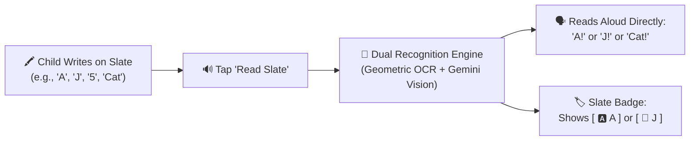

# 🖍️ Magic Slate: Write & Read Pad

[](https://reactnative.dev/)
[](https://expo.dev/)
[](https://www.typescriptlang.org/)
[](https://opensource.org/licenses/MIT)

**Magic Slate** is a digital chalkboard and early-learning slate for kids. Just like a real slate, children can write or sketch any character, number, word, or doodle with chalk. With a tap on **"Read Slate" (🔊)**, the slate **reads out the inputted content directly** in a warm, natural human voice—without long lectures or complicated paragraphs!

---

## 🌟 How the Slate Works



1. **Write on the Slate**: Use finger or stylus with chalk colors (White, Lemon Yellow, Cyan, Pink, Mint Green, Orange) or the Sponge eraser.
2. **Tap "Read Slate" (🔊)**:
   - Identifies the handwriting or drawing.
3. **The Slate Reads the Inputted Content**:
   - Write **A** $\rightarrow$ Slate directly reads: **"A!"**
   - Write **J** $\rightarrow$ Slate directly reads: **"J!"**
   - Write **5** $\rightarrow$ Slate directly reads: **"5!"** (or *"Five"*)
   - Draw **Cat** $\rightarrow$ Slate directly reads: **"Cat!"**
   - Draw **Sun** $\rightarrow$ Slate directly reads: **"Sun!"**
4. **Reading Modes**:
   - **🎯 Direct Reading (Default)**: Speaks just the content directly (*"A"*, *"J"*, *"Cat"*, *"7"*).
   - **🔤 Phonics Reading**: Speaks the content plus phonics sound (*"A! A says /æ/ as in Apple"*, *"J! J says /dʒ/ as in Juice"*).

---

## 🎨 Slate UI & Chalk Controls

- **Deep Slate Chalkboard**: Authentic dark chalkboard canvas (`#0F172A`) with subtle alignment dot grid.
- **Chalk Colors**:
  - ⚪ White Chalk (`#FFFFFF`)
  - 🟡 Lemon Yellow Chalk (`#FDE047`)
  - 🔵 Cyan Chalk (`#38BDF8`)
  - 🌸 Pink Chalk (`#F472B6`)
  - 🟢 Mint Green Chalk (`#4ADE80`)
  - 🟠 Orange Chalk (`#FB923C`)
  - 🧽 Sponge Eraser (`#1E293B`)
- **Chalk Sizes**: Thin (10px), Medium (18px), Chunky (28px).
- **Wipe Slate (🧹)**: Clean slate with realistic whoosh sound.
- **Undo (↩️)**: Instantly undo the last chalk stroke.
- **Slate Readout**: Clean badge showing `[ 🅰️ A ]` or `[ 🧃 J ]` with immediate audio replay button.

---

## 🔊 Audio & Speech Design

- **Natural Human Voice**: Anchored strictly to `pitch = 1.0` to eliminate metallic/robotic phase distortion.
- **Instant Browser Audio Unlocking**: The audio engine is automatically resumed on user touch (`resumeAudioContext()`), bypassing browser autoplay restrictions.
- **Chromium GC Protection**: Pinned utterances to `window.__speechUtterance` to prevent Chrome prematurely killing voice playback.
- **Organic Marimba Chimes**: Synthesizes soft wooden marimba chords and kalimba sparkles via `BiquadFilterNode` low-pass filtering (750 Hz–1200 Hz).

---

## 🧠 Recognition Engine

- **High-Accuracy $P Point-Cloud Matcher (Offline)**:
  - Replaces fragile if-else geometric chains with the mathematical **$P Point-Cloud Recognizer** (Wobbrock, Vatavu & Anthony).
  - **Stroke-Order Invariant**: Whether 'A' is drawn in 1, 2, or 3 strokes, or whether legs or crossbars are drawn first, the spatial point cloud matches template **'A'**.
  - **Stroke-Direction & Count Invariant**: Resamples strokes to 32 equidistant points, scales to $[0, 1] \times [0, 1]$ preserving aspect ratio, and symmetrically computes the Hausdorff distance against canonical letter and doodle templates.
  - **"Did You Mean?" Alternative Chips**: Displays the top 3 alternative candidate matches right below the readout badge, allowing children to tap any alternative for instant 1-touch correction.
  - Full template coverage: **A–Z**, **0–9**, and classic doodles (Cat, Dog, Sun, Star, Tree, House, Car, Heart).
- **Multimodal AI Vision (Google Gemini 2.5 Flash)**:
  - Supports open-vocabulary handwriting and complex sketch recognition when a free Gemini API key is configured.

---

## 🚀 Running the App

```bash
# Web browser (iPad / Tablet / Desktop)
npm run web

# iOS Simulator / Device
npm run ios

# Android Emulator / Device
npm run android
```

---

## 📄 License

MIT License.
