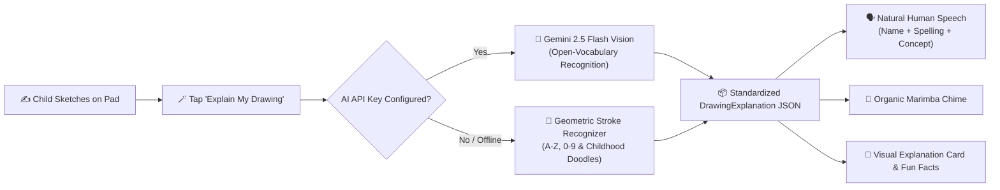

# 🎨 DoodlePad: Interactive Kids Sketch & Speak Notepad

[](https://reactnative.dev/)
[](https://expo.dev/)
[](https://www.typescriptlang.org/)
[](https://opensource.org/licenses/MIT)

**DoodlePad** is an open, tactile sketching and early-learning mobile/web application designed for young learners, parents, and educators. Children can freely draw **anything they wish**—alphabets, numbers, animals, vehicles, plants, celestial bodies, or everyday doodles. With a single tap, the sketch board identifies the drawing and **speaks a lively, kid-friendly explanation of the word, phonics spelling, and educational concepts** using a warm, natural human voice.

---

## 📋 Table of Contents

- [Vision & Core Concept](#-vision--core-concept)
- [How It Works](#-how-it-works)
- [System Architecture](#-system-architecture)
- [Audio Engineering & Acoustic Design](#-audio-engineering--acoustic-design)
  - [Eliminating Metallic & Robotic Artifacts](#eliminating-metallic--robotic-artifacts)
  - [Browser Autoplay & AudioContext Unlocking](#browser-autoplay--audiocontext-unlocking)
  - [Synthesized Organic Sound Effects](#synthesized-organic-sound-effects)
- [Drawing & Gesture Pipeline](#-drawing--gesture-pipeline)
- [Recognition Engine: Dual-Mode Architecture](#-recognition-engine-dual-mode-architecture)
  - [Mode 1: High-Accuracy Geometric Feature Matcher (Offline)](#mode-1-high-accuracy-geometric-feature-matcher-offline)
  - [Mode 2: Multimodal Gemini Vision AI (Open-Vocabulary)](#mode-2-multimodal-gemini-vision-ai-open-vocabulary)
- [Educational Dictionary & Phonics Model](#-educational-dictionary--phonics-model)
- [Project Directory Structure](#-project-directory-structure)
- [Getting Started & Installation](#-getting-started--installation)
- [Configuration & API Setup](#-configuration--api-setup)
- [Hardware & Future Expansion](#-hardware--future-expansion)

---

## 💡 Vision & Core Concept

Young children learn best through **multisensory feedback**—combining motor skills (sketching), visual recognition (seeing illustrations and spelled words), and auditory reinforcement (hearing phonetic pronunciations, rhythmic explanations, and real-world sounds). 

Rather than constraining a child to rigid tracing lines, **DoodlePad** acts like an interactive sketchbook where drawing freely is encouraged:
1. **Expressive Drawing**: Children use fingers or a stylus (Apple Pencil / S-Pen) with vibrant colors, different brush thicknesses, and an eraser.
2. **Instant Recognition**: The drawing is analyzed in real time.
3. **Auditory Explanation**: The board announces the word, spells out its phonics, and explains what the object is, how it behaves in the real world, and what sounds it makes (e.g., *"That is Letter A! A says /æ/ as in Apple!"* or *"A cat is a curious furry pet with whiskers that purrs when happy! Meow!"*).

---

## 🌟 How It Works



1. **Draw Anything**: Draw letters, numbers, or doodles on a textured digital notepad.
2. **Tap "Explain My Drawing" (🪄)**:
   - Evaluates strokes geometrically or via Gemini Vision AI.
3. **Listen to the Audio Lesson**:
   - **Name**: Spoken loudly and clearly (*"That's a Cat!"*).
   - **Phonics & Spelling**: Phonetic letter breakdown (*"C - A - T"*).
   - **Child-Friendly Explanation**: 1–2 enthusiastic sentences (*"A cat is a curious furry pet with whiskers, soft paws, and a cozy purr when happy! Meow!"*).
   - **Sound Effect Word**: Onomatopoeia audio badge (*"Meow meow!"*).
   - **Fun Fact**: An engaging trivia snippet to spark curiosity.

---

## 🏗️ System Architecture

DoodlePad is built on modern, cross-platform mobile and web standards:

| Layer | Technology | Purpose |
| :--- | :--- | :--- |
| **Framework** | **React Native (0.88.1) + Expo SDK 58** | Cross-platform runtime targeting iOS, Android, and Web browsers. |
| **Language** | **TypeScript 6.0** | Strict type-safety across all components, geometry engines, and payloads. |
| **Graphics** | **`react-native-svg`** | Scalable vector stroke rendering, pattern dot grids, and touch handling. |
| **Speech** | **`expo-speech` & Web Speech API** | Dual-tier speech synthesis with natural vocal pacing and pitch anchoring. |
| **Sound Effects**| **Web Audio API (`AudioContext`)** | Dynamic zero-asset synthesis of wooden marimba and kalimba acoustics. |
| **AI Vision** | **Google Gemini 2.5 Flash** | Multimodal image understanding of freeform children's drawings. |
| **State** | **React Hooks (`useState`, `useRef`, `useImperativeHandle`)** | Lightweight, reactive state management and stroke history stack. |

---

## 🔊 Audio Engineering & Acoustic Design

### Eliminating Metallic & Robotic Artifacts
Standard text-to-speech synthesizers often produce harsh, robotic, or "tin-can" metallic artifacts when pitch is arbitrarily manipulated or when the browser defaults to legacy system synthesizers (like `espeak`, `Fred`, or `Junior`). 

DoodlePad solves this with a multi-layered acoustic pipeline:
1. **Pitch Anchoring (`pitch = 1.0`)**: Modifying pitch via phase vocoders introduces digital phase smearing and metallic flanging. Anchoring the pitch to `1.0` preserves natural human vocal resonance.
2. **Pacing Optimization (`rate = 0.95`)**: Conversational tempo is slowed down slightly to ensure phonetic phonemes (like `/æ/` or `/buh/`) are distinctly perceptible to young children.
3. **Neural & Enhanced Voice Prioritization**:
   - Scans system voices and prioritizes natural human recordings: `Google US English`, `Samantha (Enhanced)`, `Ava (Premium)`, `Natural`, `Neural`, `Victoria`, `Karen`.
   - Explicitly rejects robotic/legacy voices (`espeak`, `zarvox`, `trinoids`, `bad news`, `pipe organ`).

### Browser Autoplay & AudioContext Unlocking
Modern browsers (Chrome, Safari, iPadOS, iOS Safari) strictly block unsolicited audio playback until user activation occurs:
- **Synchronous Resumption**: Whenever a child taps the canvas, clicks a color, or taps **"Explain My Drawing"**, `speechService.resumeAudioContext()` is synchronously triggered to wake the browser's audio bus.
- **Chrome Garbage Collection Protection**: A known Chromium V8 engine bug causes `SpeechSynthesisUtterance` instances to be garbage collected mid-speech if declared as local variables. DoodlePad pins active utterances to `window.__speechUtterance` to guarantee complete sentences are spoken without cutoff.
- **Race Condition Prevention**: In Safari and Chrome, invoking `speechSynthesis.cancel()` immediately followed by `speechSynthesis.speak()` cancels the incoming utterance. A 50ms buffer prevents race conditions.

### Synthesized Organic Sound Effects
Rather than bundling dozens of megabytes of audio files, DoodlePad synthesizes organic musical tones on the fly:
- **Wooden Marimba Celebration Chimes**: Plays an F-major chord (F4: 349 Hz, A4: 440 Hz, C5: 523 Hz, F5: 698 Hz). Each note blends a fundamental sine with a subtle second harmonic.
- **Low-Pass Biquad Filtering**: All generated tones pass through a `BiquadFilterNode` (`type = 'lowpass'`) with cutoffs between 750 Hz and 1200 Hz. This removes harsh digital overtones, producing a warm, wooden, toy-like marimba sound.
- **Tactile Wooden Pop**: When tapping buttons or picking colors, a gentle frequency glide (240 Hz down to 120 Hz) through a 750 Hz low-pass filter simulates a soft wooden block or water droplet.

---

## ✍️ Drawing & Gesture Pipeline

- **Smooth Bézier Curve Interpolation**: User touch coordinates are captured via `PanResponder` and transformed into continuous quadratic Bézier paths (`Q cx cy x1 y1`), preventing jagged polygonal lines.
- **Subtle Notebook Dot Grid**: The canvas features an SVG dot pattern (`#E2E8F0`) with 24px spacing, giving the tactile sensation of a real sketchbook.
- **Color Palette & Eraser**: High-contrast, child-friendly colors (`#1E293B`, Red `#EF4444`, Blue `#3B82F6`, Green `#10B981`, Orange `#F97316`, Purple `#8B5CF6`, Yellow `#EAB308`, and an Eraser tool).
- **Brush Sizing**: Small (8px), Medium (16px), and Chunky (26px) for little hands.
- **Instant Undo**: A stroke stack lets children undo misdrawn lines with a single tap.
- **Offscreen Canvas Rasterization**: On web platforms, the SVG vector paths are rendered to an offscreen `<canvas>` context to generate high-resolution PNG data URLs (`canvas.toDataURL('image/png')`) for multimodal AI processing.

---

## 🧠 Recognition Engine: Dual-Mode Architecture

DoodlePad employs a **fail-safe dual recognition system**: it works 100% offline out-of-the-box, with optional AI Vision superpowers.

```
                      User Sketches
                            │
              ┌─────────────┴─────────────┐
              ▼                           ▼
    Gemini API Key Available?     Offline / No Key
              │                           │
              ▼                           ▼
    Multimodal Vision AI        Geometric Feature Engine
    (Google Gemini 2.5)         (Strokes, Bounds, Hooks)
              │                           │
              └─────────────┬─────────────┘
                            ▼
              DrawingExplanation JSON Payload
```

### Mode 1: High-Accuracy Geometric Feature Matcher (Offline)

When offline or operating without an API key, DoodlePad analyzes the physical geometry and spatial topology of the normalized strokes:

#### 1. Why Letter "A" is NEVER Confused with a Tree
* **Letter A Geometry**:
  - **A-Frame Apex**: The top width (`y ∈ [0.0, 0.25]`) is narrow (`< 0.35` of total width), while the base (`y ∈ [0.75, 1.0]`) is wide (`> 0.55`).
  - **Horizontal Crossbar**: Detects a horizontal bridge stroke across the middle vertical section (`y ∈ [0.35, 0.75]`).
  - **Stroke Count**: Typically drawn with 2 or 3 strokes.
* **Tree Geometry**:
  - A tree has a **narrow trunk at the bottom** (`width < 0.35`) and an **expansive canopy on top** (`width > 0.65`). The inverted taper distinguishes trees from the triangular A-frame.

#### 2. Why Letter "J" is NEVER Confused with a Cat
* **Letter J Geometry**:
  - **Vertical Descent & Leftward Hook**: The main stroke starts at the top (`y < 0.25`), descends on the right half, and at the bottom (`y > 0.7`) **hooks sharply to the left** (`x < 0.35`) with the endpoint curving upward.
  - **Aspect Ratio**: Tall, narrow profile (`aspectRatio < 1.15`).
  - **No Closed Loops**: Letter J has no enclosed loops.
* **Cat Geometry**:
  - A cat drawing requires a closed circular head, distinct pointed triangular ears (`strokeCount >= 4`), and facial/whisker strokes.

#### 3. Other Supported Characters & Shapes
- **Letter T**: Top horizontal bar (`y < 0.3`, `width > 0.45`) + center vertical stem.
- **Letter H**: Two vertical legs connected by a horizontal crossbar.
- **Letter X**: Two crossing diagonal strokes intersecting near the center.
- **Letter L**: Left vertical line with a sharp rightward bottom turn.
- **Letter O / Number 0**: Single closed circular loop (`aspectRatio` between 0.75 and 1.25).
- **Number 1 / Letter I**: Tall vertical stroke (`aspectRatio < 0.35`).
- **Sun**: Central loop surrounded by radiating ray strokes (`strokeCount >= 5`).
- **Car**: Wide horizontal body profile (`aspectRatio > 1.4`) with wheel marks.
- **House**: Box structure topped with an angled roof (`strokeCount >= 3`).

---

### Mode 2: Multimodal Gemini Vision AI (Open-Vocabulary)

For infinite open-vocabulary recognition (e.g., distinguishing between a *"Golden Retriever"*, *"Helicopter"*, or *"Pikachu"*), DoodlePad connects to Google's **Gemini 2.5 Flash Vision API**.

#### Prompt Engineering Schema:
```json
{
  "name": "Object or Character Name (e.g. Letter A, Cat, Sun, Apple, Car)",
  "emoji": "Single cute emoji representing it",
  "spelling": "Hyphenated letter spelling (e.g. C - A - T)",
  "explanation": "A cheerful 1-2 sentence kid-friendly explanation describing what it is and what it does.",
  "soundWord": "A fun sound word (e.g. Meow meow!, Vroom vroom!)",
  "category": "Category name (Alphabet, Number, Animal, Vehicle, Nature, Food)",
  "funFact": "One fascinating kid-friendly fact about it"
}
```

The response is parsed directly into the standardized `DrawingExplanation` type and passed to the audio pipeline.

---

## 📚 Educational Dictionary & Phonics Model

The built-in offline dictionary ([`doodleDictionary.ts`](file:///Users/jayanthanayak/Side_task/Sketch_sheet/src/data/doodleDictionary.ts)) contains curated, toddler-friendly phonetic lessons:

- **Alphabet (A–Z)**:
  - Letters A through Z with phonetic sound references (*"A says /æ/ as in Apple, Astronaut, and Alligator"* to *"Z says /z/ as in Zebra, Zoo, and Zero"*).
- **Numbers (0–9)**:
  - Numerical association, counting objects, and spelling (*"Number Four! Four wheels on a family car!"*).
- **Animals & Nature**:
  - Cat 🐱, Dog 🐶, Fish 🐟, Bird 🐦, Elephant 🐘, Lion 🦁, Bear 🐻, Sun ☀️, Star ⭐, Tree 🌳, Flower 🌸, Cloud ☁️, Rainbow 🌈.
- **Vehicles & Everyday Objects**:
  - Car 🚗, Boat ⛵, Airplane ✈️, Rocket 🚀, House 🏠, Heart ❤️, Apple 🍎, Clock ⏰, Ball ⚽.

---

## 📂 Project Directory Structure

```
├── App.tsx                     # Main application layout, state & audio coordinators
├── app.json                    # Expo configuration & native permissions
├── package.json                # Project dependencies & npm scripts
├── tsconfig.json               # TypeScript configuration
├── src/
│   ├── types/
│   │   └── index.ts            # Type definitions: Stroke, Point, DrawingExplanation, etc.
│   ├── data/
│   │   ├── doodleDictionary.ts # Comprehensive educational dictionary (A-Z, 0-9, Doodles)
│   │   └── phonicsData.ts      # Reference phonics and SVG paths
│   ├── services/
│   │   ├── speechService.ts    # Unlocked human speech engine & Chromium GC protector
│   │   ├── soundEffects.ts     # Organic wooden marimba & kalimba Web Audio synthesizer
│   │   ├── geminiService.ts    # Gemini 2.5 Flash Vision + Geometric feature recognizer
│   │   └── recognitionService.ts # Tracing accuracy & keypoint evaluator
│   └── components/
│       ├── DrawingCanvas.tsx   # Touch/Stylus drawing surface with dot grid & PNG exporter
│       ├── Toolbar.tsx         # Color palette, brush sizes, eraser, undo, and explain button
│       ├── Header.tsx          # Title bar, instant audio test button, and inspiration chips
│       ├── ExplanationCard.tsx # Spoken word explanation card with replay button & fun facts
│       ├── SettingsModal.tsx   # Speech rate toggles & Gemini API key configuration
│       ├── HelpModal.tsx       # Kid-friendly visual guide
│       └── RewardModal.tsx     # Celebratory star reward modal
```

---

## 🚀 Getting Started & Installation

### Prerequisites
- **Node.js**: `v18.0.0` or later (tested on Node `v24.x`).
- **npm** or **bun**.
- **Expo Go** app on your iPad / tablet (optional, for native wireless testing).

### 1. Clone the Repository
```bash
git clone https://github.com/Jayantha1028/Interactive_sketch_board.git
cd Interactive_sketch_board
```

### 2. Install Dependencies
```bash
npm install
```

### 3. Run the Development Server

```bash
# Start in Web browser (immediate testing on iPad / desktop)
npm run web

# Run on iOS Simulator (macOS with Xcode)
npm run ios

# Run on Android Emulator (Android Studio)
npm run android
```

---

## ⚙️ Configuration & API Setup

### Using Gemini Vision for Open Recognition
DoodlePad works out-of-the-box using the built-in geometric recognizer without any API keys. 

To enable open-vocabulary AI recognition for any sketch:
1. Obtain a free Gemini API key from [Google AI Studio](https://aistudio.google.com/).
2. You can set it in two ways:
   - **In-App**: Tap the **Settings (⚙️)** icon in the top header and paste your key into the **Gemini AI Vision Key** field.
   - **Environment Variable**: Create a `.env` file in the project root:
     ```bash
     EXPO_PUBLIC_GEMINI_API_KEY="your-gemini-api-key-here"
     ```

---

## 🧪 Testing Audio & Recognition

1. **Verify Voice Output**: Tap the **"🔊 Test Voice"** button in the top-right header. You should immediately hear a clear human greeting.
2. **Draw Letter "A"**: Draw two diagonal strokes and a middle crossbar. Tap **"Explain My Drawing" (🪄)**. The app will announce **Letter A**, spell *A - P - P - L - E*, and explain the phonics.
3. **Draw Letter "J"**: Draw a descending line with a bottom curve hooking left. Tap **"Explain My Drawing"**. The app will announce **Letter J**, spell *J - U - I - C - E*, and explain the sound.
4. **Draw a Sun or Heart**: Sketch a circle or heart shape and tap **"Explain"** to hear its explanation and cheerful sound effects.

---

## 🛠️ Hardware & Future Expansion

- **Physical Pad Prototype**:
  - Can be deployed to an **ESP32-S3** microcontroller or **Raspberry Pi Zero 2W** paired with a capacitive touch screen / EMR stylus digitizer and a **MAX98357A I2S DAC amplifier** with an 8Ω speaker.
- **Multilingual Support**: Extending phonics explanations to Spanish, French, Hindi, and Mandarin.
- **Story Mode**: Recognizing multiple drawings simultaneously (e.g., drawing a cat next to a tree) and generating an audio fairy tale about them.

---

## 📄 License

This project is licensed under the [MIT License](LICENSE).
